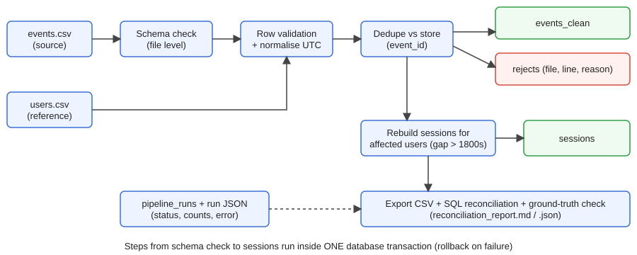

# Clickstream Sessionization Pipeline

Turns raw click/app events (CSV) into user **sessions** using event-time gaps (default 30 min), handling out-of-order and late data, duplicates, missing/invalid timestamps and boundary gaps. Python standard library + SQLite; pytest for tests. Developed and Tested locally on Python 3.13.

## Quick start (clean environment)
```bash
pip install -r requirements.txt            # only pytest, for tests
python -m pytest -q                        # 38 tests
python -m sessionization.cli generate --out-dir data/sample --events 60 --users 6 --seed 42
python -m sessionization.cli run --input data/sample/events.csv --users data/sample/users.csv --db output/sample/sessions.db --output-dir output/sample --labels-dir data/sample/labels
python scripts/run_sample_queries.py output/sample/sessions.db   # runs sql/sample_queries.sql
python scripts/benchmark.py 100000         # larger run + performance table
```
Options: `--gap-seconds 1800`, `--batch-size 500`. Exit code: 0 ok, 1 run failed, 2 reconciliation/ground-truth mismatch.

## Architecture


Text version:
```
events.csv ─► schema check ─► row validation ─► dedupe vs store ─┬─► events_clean
users.csv  ─► dim_users (reference)                              └─► rejects (source_file, line, reason, raw)
                         └── same transaction ──► recompute sessions for affected users ─► sessions
                                                  pipeline_runs (status, counts, error) ─► output/runs/<run_id>.json
sessions/rejects export + SQL reconciliation + ground-truth comparison ─► output/<dir>/
```
Modules: `config` · `validation` · `sessionize` (pure algorithm) · `store` (DDL) · `pipeline` · `generator` · `reporting` · `cli`.
Schema and rules: [docs/data_dictionary.md](docs/data_dictionary.md). Trade-offs: [docs/DESIGN.md](docs/DESIGN.md).

## Behaviour summary
| Scenario | Handling |
|---|---|
| Out-of-order events | Sorted by (event time, event_id) before sessionizing |
| Late-arriving (later file) | Sessions of affected users recomputed from all history (merge/extend/split) |
| Duplicate event_id | First wins; copy → `duplicate_event`, differing payload → `conflicting_duplicate_event` |
| Missing timestamp / required field | Row to `rejects` (`missing_timestamp`, `missing_required_field`) |
| Bad timestamp / out of range / bad type / unknown user | Row to `rejects` with reason + detail |
| Malformed row (wrong field count) | `malformed_record` |
| Missing required column (schema change) | Run FAILED, nothing loaded; extra columns ignored + reported |
| Empty file / header only | Run SUCCEEDED with 0 rows |
| Boundary gap == 1800 s | Same session; 1800 s + 1 µs starts a new one |
| Partial failure | Transaction rollback; rerun the same command |
| Rerun same input | No-op (`replayed`), identical output |
| Backfill | Files can be loaded in any order; sessions depend only on the set of accepted events. Exception: if two files carry the same event_id with different data, the first one loaded wins |

Naming: `run_id` = `run_<UTC>_<hex>`, `source_file` = file basename (must be unique per delivery), `session_id` deterministic hash.

## Evidence (in this repo)
- `output/test_results.txt` – full pytest log, 38 tests passing (happy path, empty, malformed, duplicates, nulls, boundaries, out-of-order, late-arriving, schema change, rerun, fault-injection retry, generator ground truth).
- `output/sample/` – Contains `sample_query_results.txt`, `sessions.csv`, `rejects.csv`, `reconciliation_report.md`, `reconciliation_report.json`, and `runs/*.json` for recorded run metrics. The SQLite database is generated when the pipeline runs and is not included in the repository. On a fresh run with the sample input, the expected counts are 60 new events, 7 rejected rows, and 11 sessions. Replaying the same input should identify the 60 events as replays rather than inserting them again.
- `data/sample/` – inputs; `data/sample/labels/` – expected answers kept separate; pipeline output matches them exactly (sessions and reject counts).
- `output/benchmark_results.txt` – 100k-event timings (≈23k–32k rows/s; batch size has only a small effect, the per-event session_id UPDATE is the hotspot).

## Assumptions & limitations
Naive timestamps = UTC; event_type is case-insensitive; no max session length; file-level parser errors fail the whole run; single-writer SQLite. See DESIGN.md for next steps. No secrets or external data used (all data synthetic, seed 42).

Integrity note: primary keys are enforced by SQLite; referential integrity (events -> dim_users, events -> sessions) is enforced by validation and verified by the reconciliation SQL rather than database foreign-key constraints.
